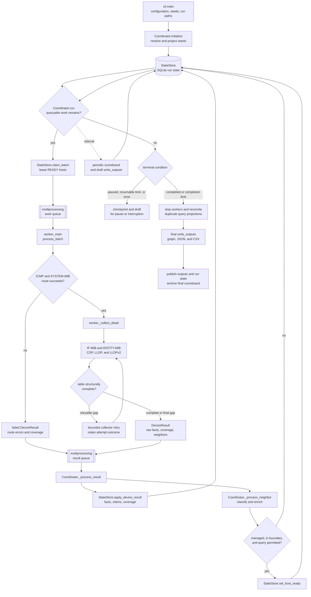
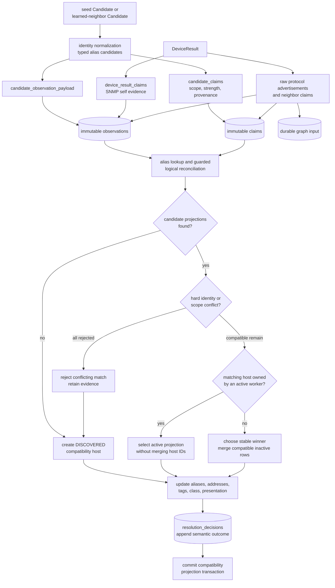
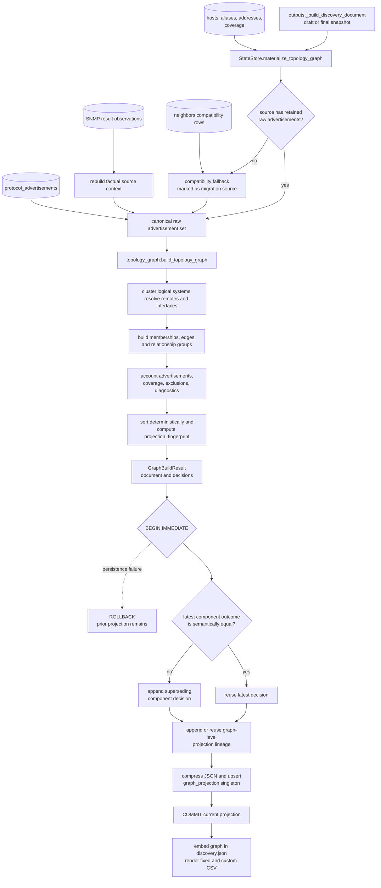

# Runtime Flow Diagrams

This reference gives contributors a source-maintained view of three paths that
are easy to misunderstand from individual functions alone:

- device collection and recursive scheduling;
- candidate identity resolution into the compatibility projection; and
- deterministic graph rematerialization from durable evidence.

The Mermaid source in this file is authoritative. No separately edited image is
required. When one of the named functions or persistence boundaries changes,
update the diagram and its notes in the same change.

These diagrams describe current behavior, not planned resolver work. In
particular, the compatibility `hosts` projection still supports scheduling and
operator reports, while the topology graph is rebuilt from retained evidence.

## Collection flow

### Collection ownership and failure rules

`Coordinator` is the only process that mutates canonical SQLite state. A worker
receives immutable `DeviceTask` batches, performs network I/O, and returns one
`DeviceResult` per task. It never writes the state database or canonical output
files directly.

`process_batch` first runs the basic route wavefront. A route must establish the
SYSTEM-MIB identity before detail collection begins. Failure across all
permitted address and credential routes returns a failed result with structured
route errors and failed SYSTEM-MIB coverage.

For a successful basic route, `_collect_detail` runs the per-device detail
chain. Interface and entity data support neighbor interpretation; CDP, LLDP,
and LLDPv2 produce raw protocol observations. A timeout, transport error, or
structurally incomplete neighbor table is not converted to an authoritative
empty table. Bounded retries update coverage and error records before the final
result is returned.

`StateStore.apply_device_result` persists the SNMP result observation, typed
claims, raw protocol advertisements, route history, table coverage, and host
state. The coordinator then processes successful neighbor observations. A
newly observed managed device becomes `READY` only after classification,
boundary policy, and query policy allow recursive polling.

Periodic snapshots call `write_outputs`, so graph rematerialization occurs for
running drafts as well as final output. Pause, configured limits that remain
resumable, and unexpected interruption retain checkpoint and draft state. A
successful terminal path stops workers, reconciles safe duplicate query
projections, writes final output, and publishes durable run artifacts.

### Collection source map

| Diagram step | Primary implementation |
| --- | --- |
| CLI and initialization | `cli.main`, `Coordinator.initialize` |
| Scheduling and leases | `Coordinator._dispatch`, `StateStore.claim_batch` |
| Worker queue loop | `worker_main`, `process_batch` |
| Basic route selection | `worker._basic_wavefront` |
| Detail collection | `worker._collect_detail`, `collectors/` |
| Result persistence | `StateStore.apply_device_result` |
| Recursive neighbor admission | `Coordinator._process_neighbor` |
| Draft and final output | `outputs.write_outputs` |

## Resolver flow

This diagram follows one seed or learned-neighbor candidate through the
incremental compatibility resolver. SNMP self-observations and raw protocol
advertisements enter the same immutable evidence ledger through a parallel
path.

### Resolver decision rules

`StateStore.upsert_candidate` wraps candidate evidence and compatibility-host
updates in one immediate SQLite transaction. Exact replay is idempotent because
observations and claims use stable fingerprints.

Claims describe what a source reported; they do not by themselves assert that
two devices are equal. Each claim carries a type, subtype, normalized value,
provenance, scope, strength, and identity-eligibility flag. Examples include a
direct protocol name, a DNS-enriched diagnostic name, a host-eligible address,
a strict Cisco SEP MAC, and an edge-scoped locally assigned chassis value.

Alias lookup and guarded logical reconciliation produce possible host rows.
Strong conflicts can reject those rows even when one value matches. Locally
scoped or diagnostic evidence cannot become unrestricted global identity.
When a compatible host is active, the resolver preserves its host ID rather
than invalidating work already leased to a worker. Compatible inactive rows may
be consolidated under a deterministic winner; otherwise a new `DISCOVERED`
compatibility row is created.

The selected compatibility row receives aliases, identity-eligible addresses,
tags, classification, and presentation updates. A resolution decision records
supporting and conflicting claim IDs plus the projected host. Repeating the
same semantic outcome can reuse the latest decision; a changed outcome appends
a superseding decision instead of rewriting evidence.

`StateStore.apply_device_result` separately records one immutable SNMP result
observation and its self claims. Before compatibility neighbor rows can merge
protocol views, `_record_protocol_advertisements_uncommitted` retains each raw
CDP, LLDP, or LLDPv2 occurrence and its typed neighbor claims. Those durable
rows are the preferred graph-rematerialization input.

The compatibility host projection is still used for scheduling, inventory, and
legacy neighbor output. It is not a substitute for immutable observations and
claims, and its current merge behavior should not be described as a fully
reversible resolver.

### Resolver source map

| Diagram step | Primary implementation |
| --- | --- |
| Candidate normalization | `identity.py`, `state.alias_tuples` |
| Factual candidate payload | `claims.candidate_observation_payload` |
| Typed candidate claims | `claims.candidate_claims` |
| Durable evidence insertion | `StateStore._record_observation_uncommitted` |
| Durable claim insertion | `StateStore._record_claims_uncommitted` |
| Compatibility resolution | `StateStore.upsert_candidate` |
| Compatible host merge | `StateStore._merge_hosts` |
| Decision history | `StateStore._record_resolution_decision_uncommitted` |
| SNMP and protocol facts | `StateStore.apply_device_result` |

## Graph rematerialization flow

`write_outputs` rebuilds the graph before serializing every draft or final
`discovery.json`. The graph is not incrementally patched from the prior graph
payload.

### Rematerialization guarantees

`materialize_topology_graph` reads the complete current host projection,
identity aliases, host addresses, collection coverage, immutable SNMP result
observations, and raw protocol advertisements. Source context is reconstructed
from the exact SNMP observation referenced by each protocol row when available.

For state that lacks retained raw rows, compatibility advertisements are built
from `neighbors`. They are admitted only for source hosts without preferred raw
advertisements and are marked as compatibility or migration evidence. This
fallback prevents older resumable state from producing no graph while keeping
its lower authority visible.

`build_topology_graph` performs deterministic logical-host clustering, remote
entity resolution, interface construction, memberships, relationships, and
relationship-group analysis. Every input advertisement must be materialized or
explicitly excluded. Duplicate advertisement keys fail the build rather than
publishing an ambiguous graph. Canonical ordering feeds one stable projection
fingerprint.

The graph document is built before the publication transaction. During the
transaction, each changed component appends a decision that supersedes its
previous semantic outcome. An unchanged component reuses its latest decision.
A graph-level lineage decision is also recorded because a split or merge can
replace all prior component keys.

Only after decisions are recorded is the canonical graph compressed and the
singleton `graph_projection` row replaced. A persistence exception rolls back
both decisions and the replacement, leaving the previous current projection
intact. A successful commit returns the same graph document to `write_outputs`,
which embeds it in `discovery.json` and derives CSV output from that canonical
in-memory document.

### Graph source map

| Diagram step | Primary implementation |
| --- | --- |
| Snapshot trigger | `outputs._build_discovery_document` |
| Evidence assembly | `StateStore.materialize_topology_graph` |
| Canonical raw records | `topology_graph.canonical_raw_advertisements` |
| Graph construction | `topology_graph.build_topology_graph` |
| Component history | `_record_graph_component_decision_uncommitted` |
| Current projection | SQLite `graph_projection` |
| Output serialization | `outputs.write_outputs` |

## Maintenance checklist for these diagrams

Update this reference when a change does any of the following:

- moves ownership of canonical state across a process boundary;
- adds or removes a collection phase, retry, or table-completeness decision;
- changes candidate alias eligibility, hard conflicts, active-host protection,
  or host-merge selection;
- adds a durable evidence or decision table used by graph construction;
- changes compatibility-fallback conditions;
- changes graph component lineage, transaction ordering, or rollback behavior;
  or
- changes which graph document feeds `discovery.json` and CSV output.

Do not add a rendered image without keeping the Mermaid source here. Tests check
that all three diagrams and their named implementation anchors remain present;
they do not prove that the arrows are semantically correct. Code review must
still compare a behavior change against this file.
